# Mini-CMS

## Description

**Mini-CMS** est une plateforme de publication de contenu développée avec Laravel 13, PHP 8.3+ et SQLite dans le cadre de l'Atelier Framework Côté Serveur (3e année MDW, ISET Sidi Bouzid).

Le projet combine un site web public avec rendu côté serveur (Blade), un back-office d'administration sécurisé par authentification et autorisations, ainsi qu'une API RESTful complète protégée par jetons d'accès personnels (Laravel Sanctum).

Auteur : Malek Abdelmaksoud, groupe MDW32.

## Fonctionnalités

- **Consultation publique** : Page d'accueil, liste paginée des articles publiés, lecture détaillée d'un article, navigation par catégories et par tags, archives annuelles.
- **Authentification complète** : Inscription, connexion, déconnexion avec protection CSRF, hachage des mots de passe (Bcrypt/Argon2) et régénération de session.
- **Gestion des rôles et autorisations** : Deux rôles distincts (`admin` et `author`). Les administrateurs accèdent à la gestion complète des catégories et des tags ainsi qu'au changement de rôles des utilisateurs. Les auteurs gèrent uniquement leurs propres articles.
- **Brouillons et visibilité** : Contrôle d'accès fin via `PostPolicy` et le scope Eloquent `visibleTo()` (un brouillon n'est visible que par son auteur et les administrateurs).
- **API RESTful JSON** :
  - Consultation en lecture seule des catégories, des tags et des articles avec comptage des articles publiés (`posts_count`).
  - Filtrage des articles par catégorie (`?category=slug`) et par tag (`?tag=slug`) avec validation stricte des paramètres.
  - Réponses normalisées via des API Resources (`PostResource`, `CategoryResource`, `TagResource`), timestamps ISO 8601 et pagination.
  - Émission et révocation de jetons personnels Sanctum (`/api/login`, `/api/logout`).
  - Opérations de création, modification et suppression d'articles protégées par jeton Bearer (`auth:sanctum`), soumises aux mêmes règles de validation (`StorePostRequest`, `UpdatePostRequest`) et d'autorisation (`PostPolicy`) que le site web.
- **Qualité et tests** : Suite de tests automatisés Pest couvrant le routage, l'authentification, les politiques d'accès, ainsi que les opérations en lecture et écriture de l'API.

## Installation

### Bash

```bash
git clone https://github.com/malekabdelmaksoud/laravel.git mini-cms
cd mini-cms
composer install
npm install
npm run build
cp .env.example .env
php artisan key:generate
php artisan migrate:fresh --seed
php artisan test
composer run dev
```

### PowerShell

```powershell
git clone https://github.com/malekabdelmaksoud/laravel.git mini-cms
cd mini-cms
composer install
npm install
npm run build
copy .env.example .env
php artisan key:generate
php artisan migrate:fresh --seed
php artisan test
composer run dev
```

L'application est accessible à l'adresse [http://localhost:8000](http://localhost:8000).

## Comptes de test

Les comptes suivants sont initialisés par les seeders (`DatabaseSeeder`) :

| Rôle | Adresse e-mail | Mot de passe | Description |
|---|---|---|---|
| Administrateur | `test@example.com` | `password` | Accès complet au back-office (`/admin`), gestion des catégories, des tags et des rôles. |
| Auteur | `ed.grant@example.com` | `password` | Compte auteur pouvant rédiger, modifier et publier ses propres articles. |

## API

### Endpoints

Toutes les routes d'API sont préfixées par `/api` :

| Méthode | URI | Nom de route | Protection | Action / Description |
|---|---|---|---|---|
| `GET` | `/api/categories` | `api.categories.index` | Public | Liste des catégories avec `posts_count` (articles publiés). |
| `GET` | `/api/categories/{category}` | `api.categories.show` | Public | Détail d'une catégorie avec `posts_count`. |
| `GET` | `/api/tags` | `api.tags.index` | Public | Liste des tags avec `posts_count`. |
| `GET` | `/api/tags/{tag}` | `api.tags.show` | Public | Détail d'un tag avec `posts_count`. |
| `GET` | `/api/posts` | `api.posts.index` | Public | Liste paginée des articles publiés (filtres : `?category=`, `?tag=`, `?per_page=`). |
| `GET` | `/api/posts/{post}` | `api.posts.show` | Public / Gate | Détail d'un article (`body` inclus ; 403 pour un brouillon non autorisé). |
| `POST` | `/api/login` | `api.login` | Public | Connexion avec e-mail et mot de passe, renvoie un jeton Bearer. |
| `POST` | `/api/logout` | `api.logout` | `auth:sanctum` | Révocation et suppression du jeton d'accès courant (204 No Content). |
| `POST` | `/api/posts` | `api.posts.store` | `auth:sanctum` | Création d'un article pour l'utilisateur authentifié (201 Created). |
| `PUT/PATCH` | `/api/posts/{post}` | `api.posts.update` | `auth:sanctum` | Mise à jour d'un article appartenant à l'utilisateur authentifié. |
| `DELETE` | `/api/posts/{post}` | `api.posts.destroy` | `auth:sanctum` | Suppression d'un article (204 No Content). |
| `GET` | `/api/user` | - | `auth:sanctum` | Profil de l'utilisateur associé au jeton Bearer. |

### Authentification par jeton

L'API utilise **Laravel Sanctum**. Lors d'un appel réussi à `POST /api/login`, l'API génère un jeton d'accès personnel en texte clair (au format `id|cle_aleatoire`). Ce jeton n'est affiché qu'une seule fois : la base de données stocke uniquement son empreinte de hachage SHA-256 dans la table `personal_access_tokens`.

Pour accéder aux routes protégées, le client doit inclure le jeton dans chaque requête via l'en-tête HTTP :

```http
Authorization: Bearer <VOTRE_JETON>
Accept: application/json
```

### Codes d'erreur

L'API communique les résultats via les codes d'état HTTP standards, accompagnés d'un corps de réponse en JSON :

- **`200 OK`** : Requête traitée avec succès.
- **`201 Created`** : Ressource créée avec succès (ex. émission de jeton ou création d'article).
- **`204 No Content`** : Action effectuée avec succès sans contenu en retour (ex. déconnexion ou suppression).
- **`401 Unauthorized`** : Requête non authentifiée (jeton manquant, invalide ou révoqué).
- **`403 Forbidden`** : Accès refusé par les politiques d'autorisation (`PostPolicy`) ou tentative de modification de la ressource d'un tiers.
- **`404 Not Found`** : Ressource inexistante (catégorie, tag ou article introuvable).
- **`422 Unprocessable Content`** : Échec de validation des données transmises (`StorePostRequest`, `UpdatePostRequest`, `IndexPostRequest`), avec messages explicatifs en français.

### Exemple curl.exe

Exemple d'appel de déconnexion révoquant le jeton auprès de l'API :

```bash
curl.exe -X POST -H "Accept: application/json" -H "Authorization: Bearer VOTRE_JETON" http://localhost:8000/api/logout
```

*(Remplacer `VOTRE_JETON` par un jeton valide obtenu lors de l'appel à `POST /api/login` ; la commande renvoie un code `204 No Content` sans corps).*

## Captures d'écran

### Session 01 à 03 : Démarrage et layout


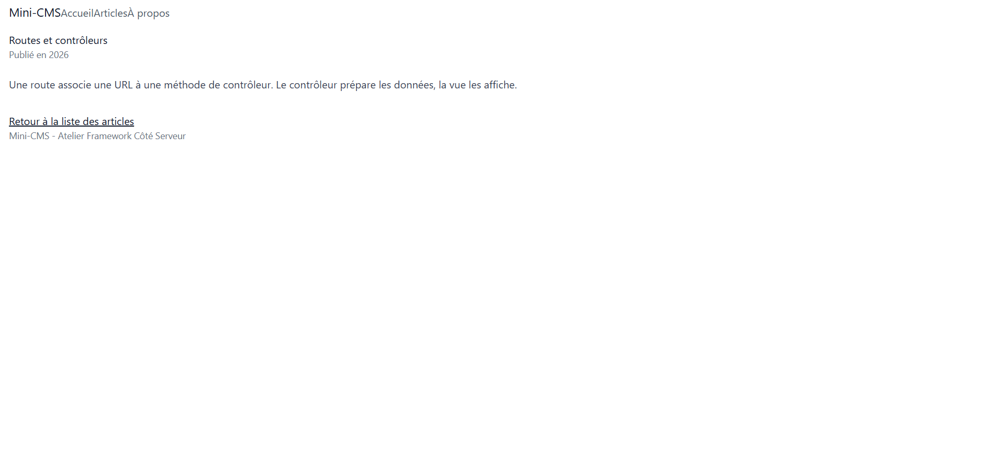

### Session 06 : Modifications et suppressions

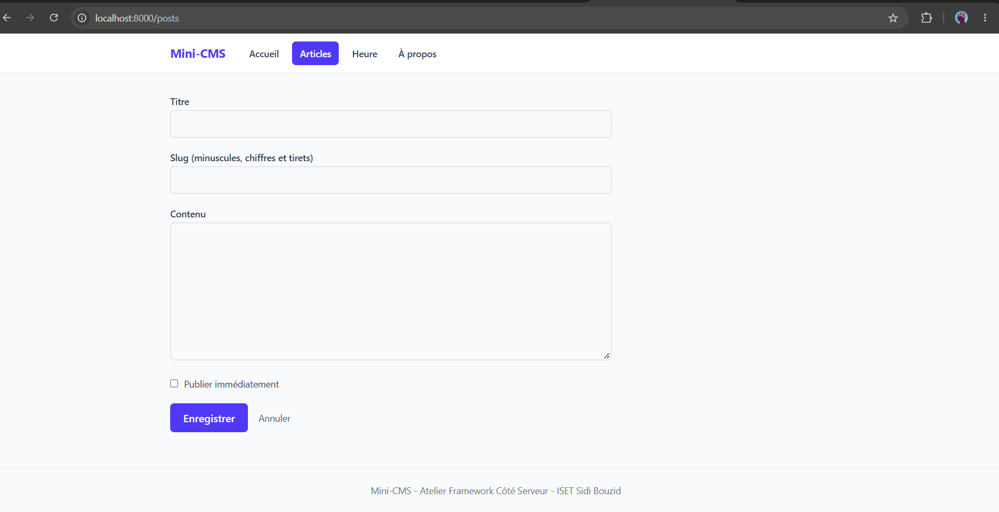


### Session 07 & 08 : Relations, catégories et tags

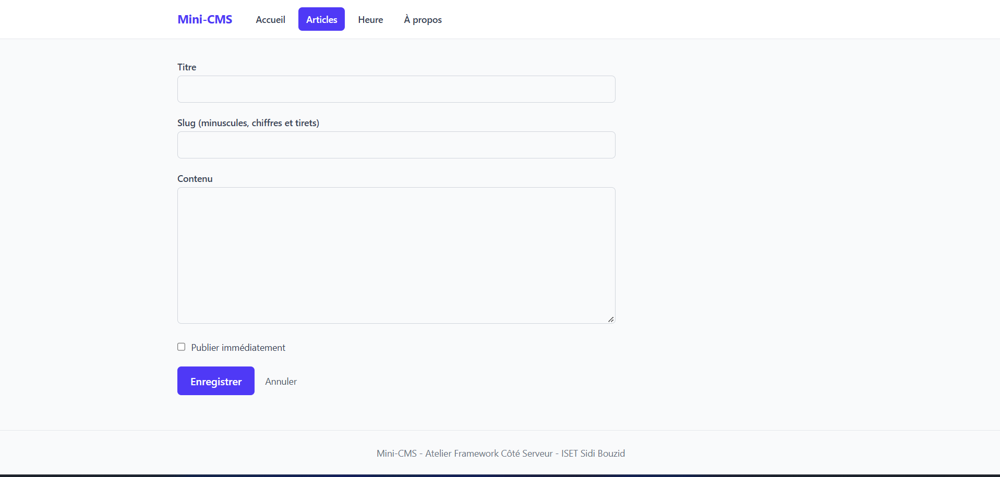

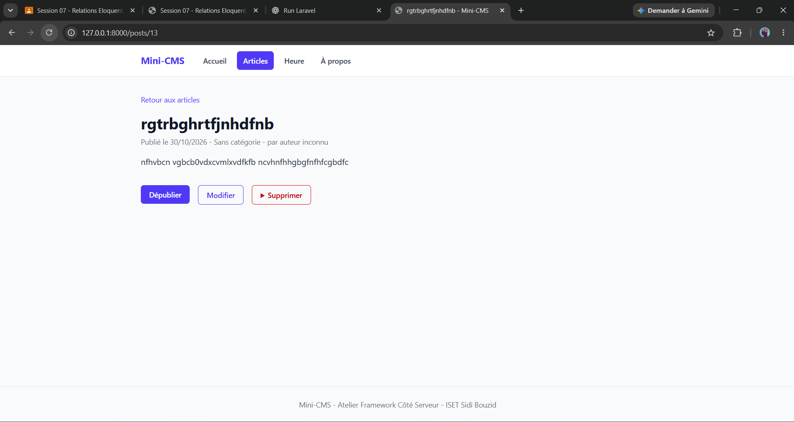


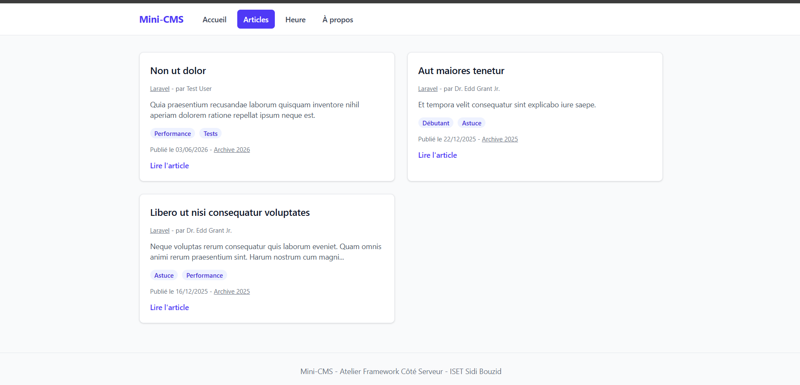

### Session 10 : Back-office et robustesse


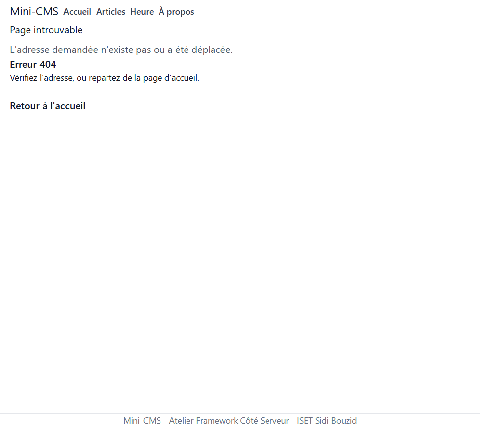

### Session 11 : Authentification manuelle

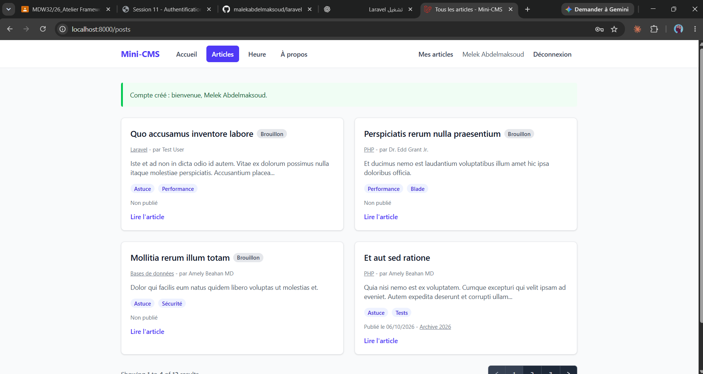

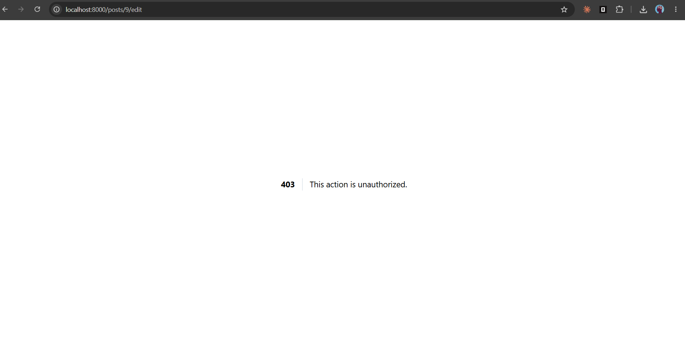

### Session 12 : Rôles et autorisations


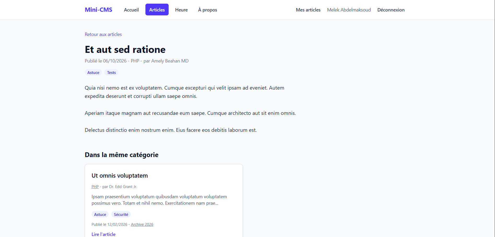

### Session 13 : API en lecture seule

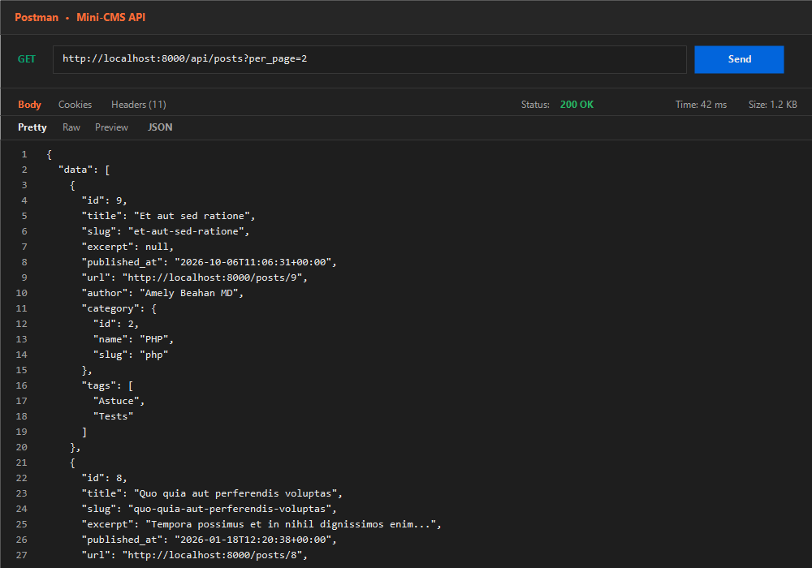

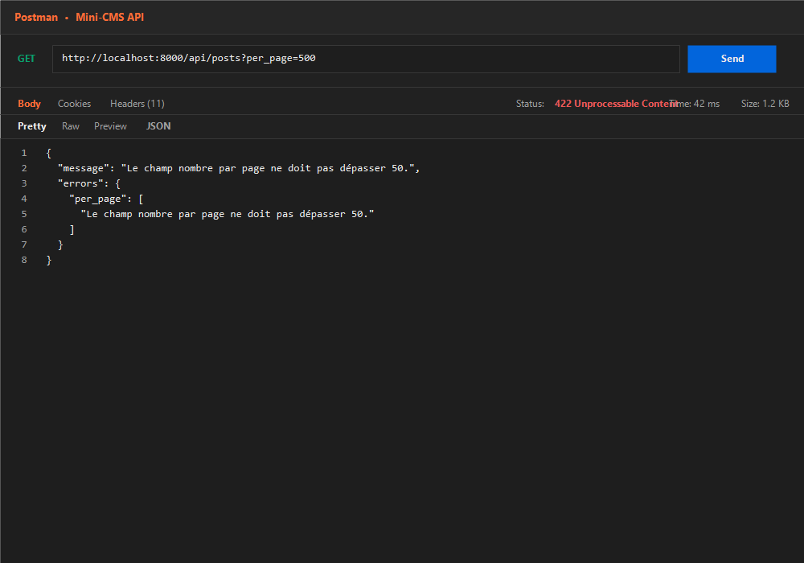

### Session 14 : API complète et jetons Sanctum

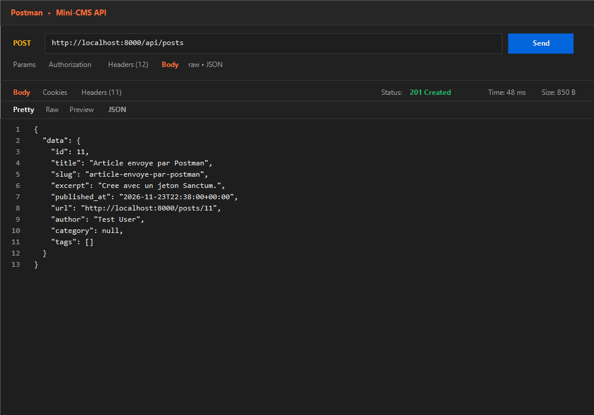

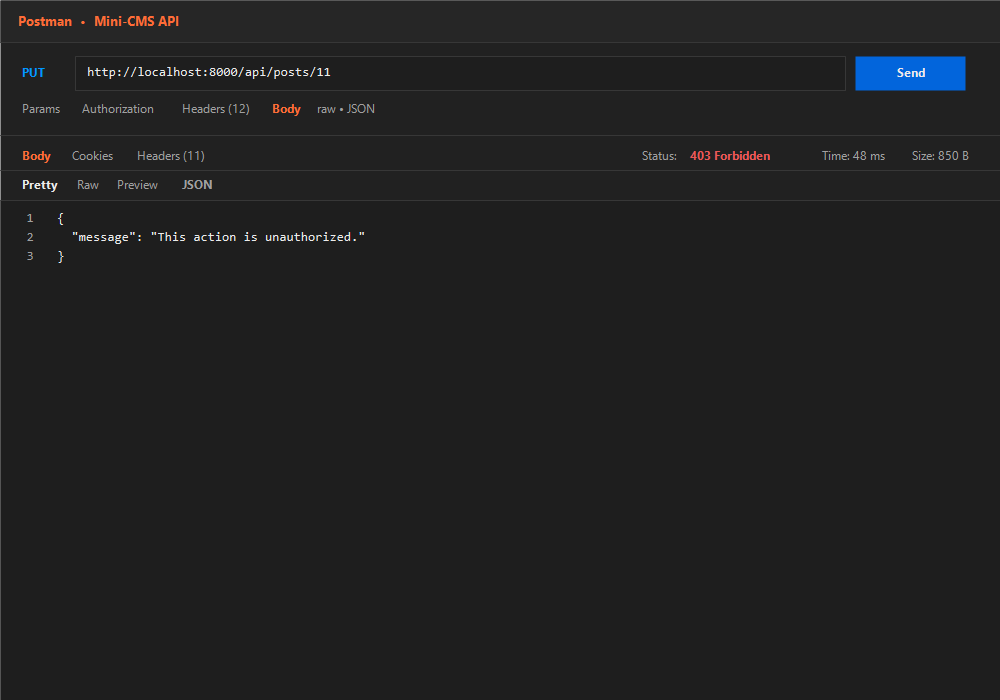

## Choix d'architecture

### Pourquoi les écritures de l'API passent par PostPolicy

Une seule règle d'autorisation doit régir le droit de consulter, modifier ou supprimer un article, qu'il s'agisse d'une action initiée depuis l'interface web (Blade) ou d'une requête envoyée à l'API JSON. En centralisant cette logique dans `PostPolicy` et en l'invoquant systématiquement dans les contrôleurs (`Gate::authorize`) et les Form Requests (`authorize()`), toute évolution d'une règle métier s'applique instantanément et uniformément à l'ensemble du système. Cela élimine les duplications de code et garantit que l'API ne puisse en aucun cas devenir une porte dérobée permettant de contourner les restrictions imposées sur le site web.

### Pourquoi preventLazyLoading est activé

L'activation de `Model::preventLazyLoading(! app()->isProduction())` protège l'application contre le piège classique des requêtes N+1 : charger une collection d'enregistrements puis accéder à une relation non chargée au sein d'une boucle déclenche une requête SQL distincte pour chaque élément, dégradant sévèrement les performances de la base de données. En environnement local et de test, cette directive lève immédiatement une exception explicite (`LazyLoadingViolationException`), forçant le développeur à anticiper le chargement via `with()`, `load()` ou `whenLoaded()`. Elle demeure inactive en production afin d'éviter d'interrompre le service aux utilisateurs finaux en cas d'omission mineure.

### Pourquoi l'API utilise des jetons et non la session

Le protocole HTTP pour les API web est traditionnellement sans état (*stateless*). Le groupe de routes `api` n'active volontairement aucun middleware de session ni de cookie, ce qui permet à l'API de répondre à des clients hétérogènes (applications mobiles, scripts automatisés en ligne de commande, services tiers ou Postman) qui ne disposent pas d'un moteur de cookies de navigateur. L'authentification par jeton Bearer oblige le client à fournir explicitement sa preuve d'identité à chaque requête dans l'en-tête `Authorization`. De plus, chaque jeton peut être révoqué indépendamment lors d'un appel à `/api/logout`, offrant une gestion granulaire des sessions multi-appareils sans compromettre les autres connexions actives.
