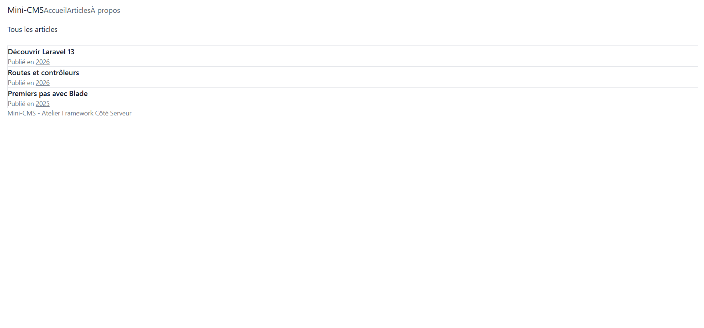
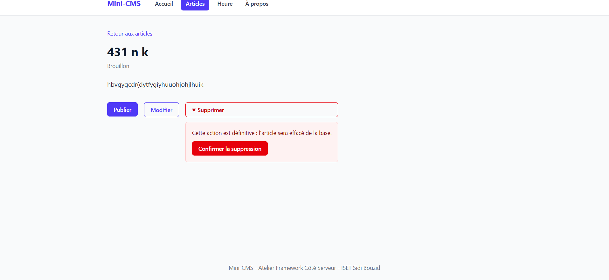
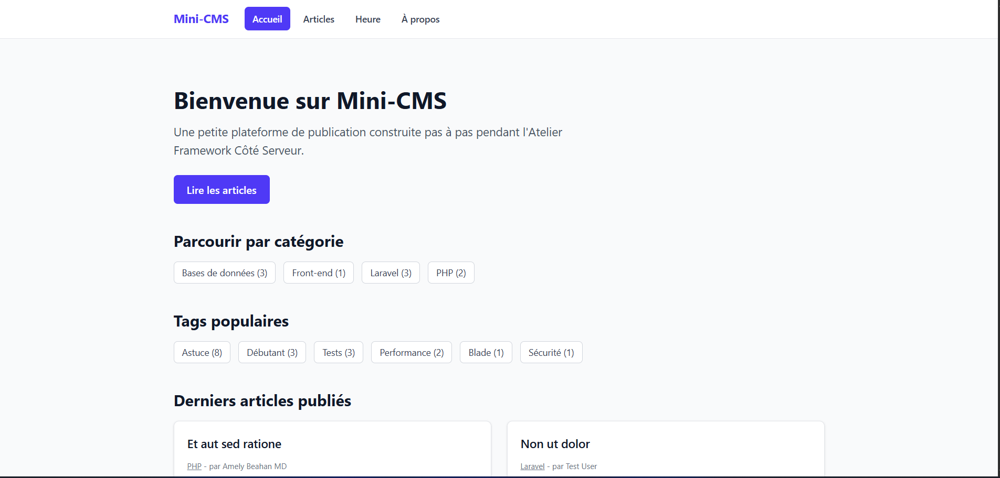
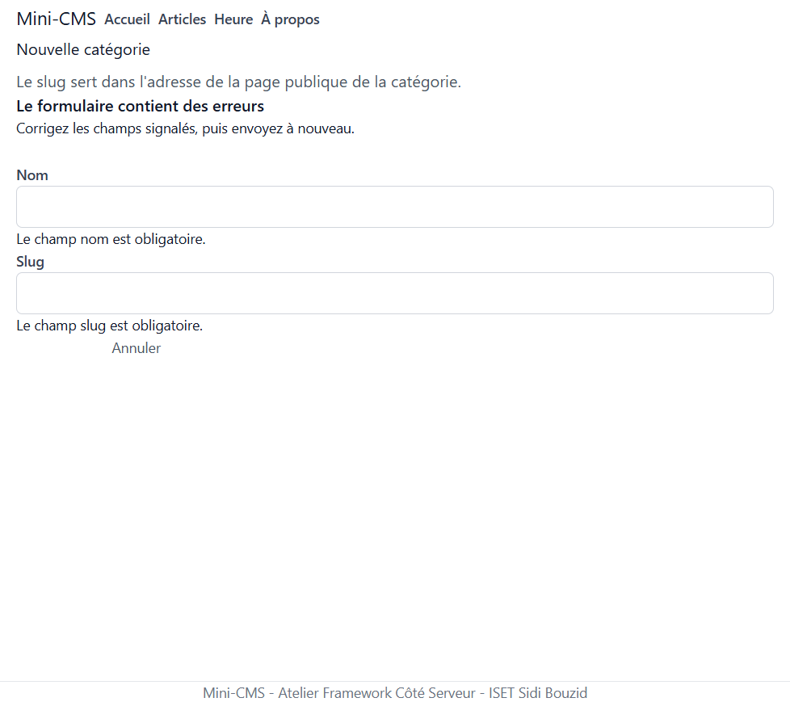

**# Mini-CMS**

Projet fil rouge de l'Atelier Framework Côté Serveur (Laravel 13, PHP 8.3+), 3e année MDW, ISET Sidi Bouzid.

Auteur : Prenom Nom, groupe MDW32.

Mini-CMS évoluera au fil du semestre vers une petite plateforme de publication : pages publiques, back-office authentifié, API JSON et tests Pest. Chaque session se termine par un tag Git (\`lab-01\`, \`lab-01b\`, puis un tag par session).
## État actuel (Session 12 — Lab 06b en préparation)

- Back-office des catégories et des tags sous `/admin`, protégé par le middleware `admin` ; seuls les administrateurs peuvent y accéder.
- Gates `manage-categories` et `manage-tags` appliqués aux contrôleurs, aux Form Requests et aux liens du menu.
- Les brouillons sont protégés par `PostPolicy` : ils sont visibles uniquement par leur auteur et les administrateurs.
- Le scope `Post::visibleTo()` applique la même règle dans la liste publique `/posts`.
- Tests d'autorisation : `AdminAccessTest` (7 tests) et `PostVisibilityTest` (5 tests), en complément des tests fonctionnels existants.
- Les captures de la Session 12 et la validation finale de `php artisan test` restent à effectuer localement avant de poser et publier le tag `lab-06b`.

## Données de démonstration

Après un clone, reconstruire la base avec `php artisan migrate:fresh --seed`. Attention : cette commande vide la base avant de la remplir.

**## Installation**

**### Bash (Git Bash, macOS, Linux)**

\`\`\`bash
git clone [https://github.com/VOTRE-UTILISATEUR/mini-cms.git](https://github.com/VOTRE-UTILISATEUR/mini-cms.git)
cd mini-cms
composer install
npm install
cp .env.example .env
php artisan key:generate
touch database/database.sqlite
php artisan migrate
composer run dev
\`\`\`

**### PowerShell (Windows)**

\`\`\`powershell
git clone [https://github.com/VOTRE-UTILISATEUR/mini-cms.git](https://github.com/VOTRE-UTILISATEUR/mini-cms.git)
cd mini-cms
composer install
npm install
copy .env.example .env
php artisan key:generate
New-Item database\database.sqlite -ItemType File
php artisan migrate
composer run dev
\`\`\`

Ouvrir ensuite [http://localhost:8000](http://localhost:8000) (adresse de l'application, différente de l'adresse de Vite sur le port 5173).

**## Captures d'écran**
### Accueil avec le layout

### Liste des articles

### Détail d'un article

**### Page d'accueil**

![Page d'accueil de Mini-CMS]\(screenshots/s01-accueil.png)

**### Page Bienvenue**

![Page Bienvenue]\(screenshots/s01-bienvenue.png)

**### Liste des routes**

![Sortie de php artisan route:list]\(screenshots/s01-route-list.png)

**### Page À propos**

![Page A propos]\(screenshots/s02-a-propos.png)
### Session 04

### Session 05

### Session 06

### Session 07

### Session 08

### Session 10

Back-office des catégories et des tags, messages de validation en français, pages 404 et 503 dans le layout du site.

### Lab 06 — Session 11

- Connexion vérifiée : le nom de l’utilisateur connecté et le message « Vous êtes connecté. » sont affichés.
- Autorisation vérifiée : un utilisateur connecté ne peut pas modifier l’article n° 9, appartenant à un autre auteur ; Laravel répond `403 – This action is unauthorized.`.
- Captures à conserver dans le dossier `screenshots/` :
  - `s11-connexion.png` — page après connexion.
  - `s11-interdit.png` — réponse 403 sur `/posts/9/edit`.

## Routes disponibles

| Méthode | URI | Nom | Action |
|---|---|---|---|
| GET | `/` | `home` | `PageController@home` |
| GET | `/a-propos` | `about` | `PageController@about` |
| GET | `/heure` | `time` | `PageController@time` |
| GET | `/posts` | `posts.index` | `PostController@index` |
| GET | `/posts/archive/{year}` | `posts.archive` | `PostController@archive` |
| GET | `/posts/categorie/{category:slug}` | `posts.category` | `PostController@byCategory` |
| GET | `/posts/tag/{tag:slug}` | `posts.tag` | `PostController@byTag` |
| GET | `/posts/create` | `posts.create` | `PostController@create` |
| POST | `/posts` | `posts.store` | `PostController@store` |
| GET | `/posts/{post}` | `posts.show` | `PostController@show` |
| GET | `/posts/{post}/edit` | `posts.edit` | `PostController@edit` |
| PUT | `/posts/{post}` | `posts.update` | `PostController@update` |
| DELETE | `/posts/{post}` | `posts.destroy` | `PostController@destroy` |
| PATCH | `/posts/{post}/publication` | `posts.publication` | `PostController@togglePublication` |
| GET | `/admin/categories` | `admin.categories.index` | `CategoryController@index` |
| GET | `/admin/categories/create` | `admin.categories.create` | `CategoryController@create` |
| POST | `/admin/categories` | `admin.categories.store` | `CategoryController@store` |
| GET | `/admin/categories/{category}/edit` | `admin.categories.edit` | `CategoryController@edit` |
| PUT | `/admin/categories/{category}` | `admin.categories.update` | `CategoryController@update` |
| DELETE | `/admin/categories/{category}` | `admin.categories.destroy` | `CategoryController@destroy` |
| GET | `/admin/tags` | `admin.tags.index` | `TagController@index` |
| GET | `/admin/tags/create` | `admin.tags.create` | `TagController@create` |
| POST | `/admin/tags` | `admin.tags.store` | `TagController@store` |
| GET | `/admin/tags/{tag}/edit` | `admin.tags.edit` | `TagController@edit` |
| PUT | `/admin/tags/{tag}` | `admin.tags.update` | `TagController@update` |
| DELETE | `/admin/tags/{tag}` | `admin.tags.destroy` | `TagController@destroy` |

### Session 12 — Autorisation et rôles

- Middleware `admin` enregistré dans `bootstrap/app.php` et appliqué à toutes les routes du back-office `/admin`.
- Les utilisateurs ayant le rôle `author` reçoivent une réponse 403 ; les administrateurs accèdent à la gestion des catégories et des tags.
- Gates `manage-categories` et `manage-tags` : les liens correspondants sont affichés uniquement aux administrateurs.
- Les Form Requests et le contrôleur des tags vérifient le Gate `manage-tags`.
- La `PostPolicy` couvre la consultation, la création, la modification et la suppression des articles. Les brouillons ne sont visibles que par leur auteur et les administrateurs, sur leur page et dans `/posts` grâce au scope `visibleTo()`.
- Tests d'autorisation : `tests/Feature/AdminAccessTest.php` (7 tests) et `tests/Feature/PostVisibilityTest.php` (5 tests).

Les tests doivent être exécutés localement avec `php artisan test` avant la validation finale.

## Comparaison avec le starter kit Livewire

| Critère | Mini-CMS (authentification manuelle) | Starter kit Livewire |
|---|---|---|
| Routes d'authentification | Définies dans `routes/web.php` : inscription, connexion et déconnexion. | Enregistrées par Fortify depuis son paquet ; absentes de `routes/web.php`. |
| Inscription | `Auth\\RegisterController`. | `app/Actions/Fortify/CreateNewUser.php` et `resources/views/pages/auth/register.blade.php`. |
| Connexion | `Auth\\LoginController::store` avec `Auth::attempt()` et régénération de session. | Contrôleur Fortify et `resources/views/pages/auth/login.blade.php`. |
| Déconnexion | `Auth\\LoginController::destroy` : logout, invalidation de session et régénération du token CSRF. | Route logout de Fortify et `app/Livewire/Actions/Logout.php`. |
| Limitation des tentatives | Non implémentée dans Mini-CMS. | 5 tentatives par minute par e-mail et adresse IP, selon la configuration du kit étudiée dans le cours. |
| Mot de passe oublié | Non implémenté. | Fonctionnalité de réinitialisation activable dans `config/fortify.php`. |
| Vérification de l'e-mail | Non implémentée. | Fonctionnalité prévue par Fortify ; middleware `verified` sur le tableau de bord. |
| Double authentification et passkeys | Non implémentées. | Fonctionnalités proposées par Fortify et configurables dans `config/fortify.php`. |
| Rôles et autorisations | Colonne `role`, Gates, `PostPolicy` et middleware `admin`. | À développer dans l'application : le starter kit ne définit pas les rôles métier. |
| Tests | Tests Pest dans `tests/Feature`, notamment authentification et autorisations. | Tests du kit dans `tests/Feature`, écrits avec PHPUnit dans le dépôt étudié. |

Dans un vrai projet, je garderais du starter kit la gestion de l'authentification et les fonctions de sécurité déjà éprouvées. Je continuerais à écrire moi-même les rôles et les autorisations, car elles dépendent des règles métier propres à l'application.
